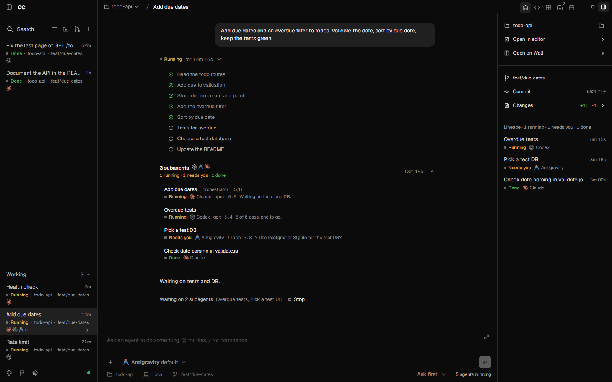
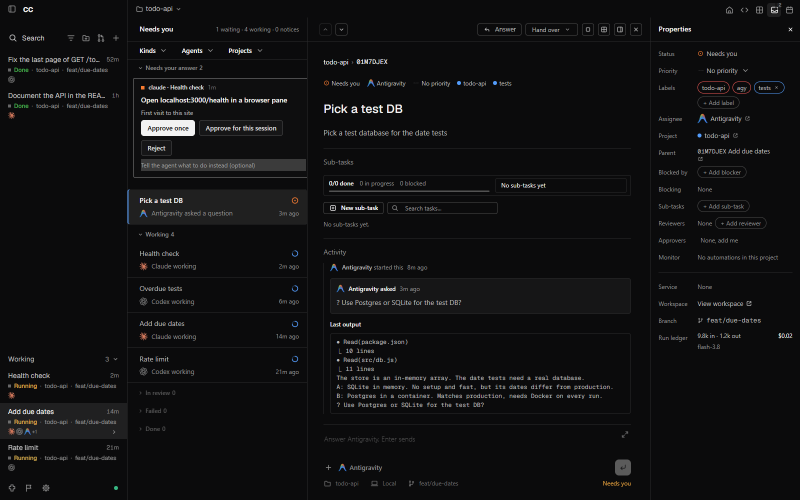
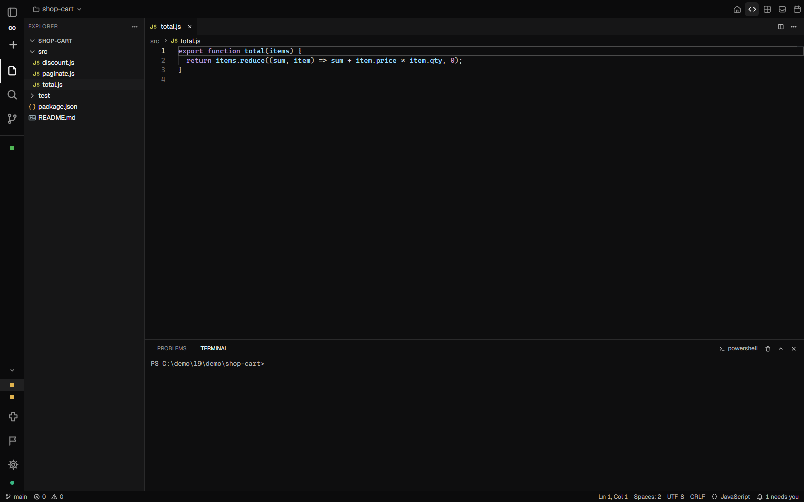
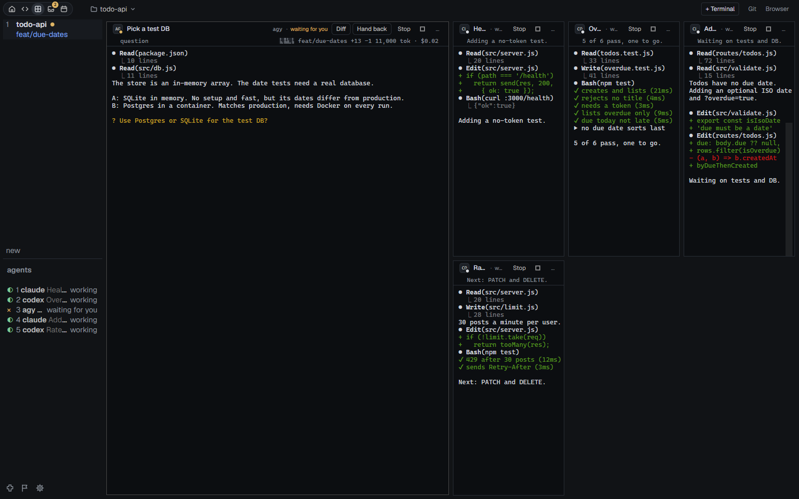

<p align="center">
  <strong>Carbon Copy (cc) rebuilds the apps you already code with, an editor, terminals, an inbox and a browser, as one Windows
  app where every agent is just a task, so there are no sessions to manage.</strong><br>
  New to Claude Code? Type a task instead of facing a blank terminal. Already running five sessions? Stop juggling
  them. Claude Code, Codex, Gemini CLI and other agents run side by side. Free and open source.
</p>

<p align="center"><strong>Windows first. Install from source. Local only: no account, no telemetry.</strong></p>

<p align="center">
  <a href="#quickstart"><strong>Quickstart</strong></a> &middot;
  <a href="#what-it-is"><strong>What it is</strong></a> &middot;
  <a href="#the-wall"><strong>The wall</strong></a> &middot;
  <a href="#browser-use"><strong>Browser use</strong></a> &middot;
  <a href="#computer-use-windows"><strong>Computer use</strong></a> &middot;
  <a href="#core-services"><strong>Core services</strong></a> &middot;
  <a href="#privacy"><strong>Privacy</strong></a> &middot;
  <a href="#known-limits"><strong>Known limits</strong></a> &middot;
  <a href="#faq"><strong>FAQ</strong></a>
</p>

<p align="center">
  
  
  
  
</p>

<div align="center">

| 7 | 0 | 0 | 1,504 | 2,000+ |
|:--:|:--:|:--:|:--:|:--:|
| CLI agents supported | accounts to create | telemetry | core tests | commits |

</div>

<p align="center"></p>

## What it is

You run three agents in three terminals, with an editor and a browser in more windows again. You lose
track of which one is waiting on you. cc rebuilds those apps as one window, each a close copy of a screen you
already know, with the agents built in. You do not manage sessions: you type a task, cc starts the agent and keeps
its terminal running, and the task comes to you when it needs an answer. You read, answer and steer every agent
from that one window.

The window has these screens:

| Screen | Looks like | What the agents do there |
|---|---|---|
| **Home** | A task list with a box to type a new one | You type a task and pick the agent. Each task shows its agents, subagents and current steps. |
| **IDE** | A VS Code style editor: file tree, tabs, search, source control, Problems and a terminal | Files an agent changed are marked. A comment on a line of a diff goes to that agent as your next message. |
| **Wall** | A grid of terminals | Every agent is a live terminal tile. The one waiting for you comes to the big slot. Its diff, git and browser open beside it. |
| **Needs you** | An inbox laid out like an issue tracker, with filters and labels | Every question, approval and finished run that waits on you. You answer from here. |
| **Add-ons** | A list of extensions | The agents cc found and the plugins you installed, each with its permissions. |
| **Settings** | A settings page | Approvals, notifications, the take-over key and the rest. Automations live here too. |



Built in around the screens:

| Part | What it does |
|---|---|
| **Browser use** | Agents drive browser panes inside the app. New sites, password fields and send buttons stop for your approval. |
| **Computer use** (Windows) | Agents act on the app windows you give them, with their own visible cursor. One key takes over. |
| **Core services** | A background service owns the terminals. Sessions come back after a restart, dev servers get previews, and other tools can drive it. |

cc runs the official CLIs you install and sign in to yourself. It never signs in for you and never reads their login
tokens. It is not affiliated with or endorsed by Anthropic, OpenAI, Google or Microsoft.

The repo, the `troop` command, the `~/.metatrooper/` folder and the package names still use the old name
MetaTrooper. The window's mark says cc; some Settings and Add-ons text still says Ouros.

## What's next

Plans that are not built yet live in [`ouros-spec.md`](ouros-spec.md) and [`spec.md`](spec.md). This page lists only
what runs today.

## Quickstart

There is no installer yet. You run cc from a clone of this repo.

You need:

- Windows 10 or 11. These steps were tested on Windows 11.
- Node 24.16 or newer (tested on 24.18).
- At least one agent CLI installed and signed in: `claude`, `codex`, `gemini` or `agy`.
- A network connection for the first run.

```bash
git clone https://github.com/Wasif-ZA/metatrooper
cd metatrooper/core && npm ci
cd ../workbench && npm ci
cd ..
node core/cli.ts start          # starts the core in the background
node core/cli.ts ping           # checks the core is up
node core/cli.ts skills install # optional: copies the bundled agent skills
cd workbench && npm run dev     # opens the window; needs a desktop session
```

What to expect:

- `npm ci` in `workbench/` downloads Electron and builds the editor files, so it takes a minute and needs network.
- `npm ci` in `core/` may warn about scripts for `node-pty`. It is only a warning.
- `npm ci` in `workbench/` may report vulnerabilities from `npm audit`. They do not stop the install.
- On first run the window asks how agents should start: ask before each tool call (the default) or auto mode in
  worktrees. You can change it later in `~/.metatrooper/settings.json` (`sessions.approval`).
- From source, `troop` in any message or below means `node core/cli.ts`.

> [!WARNING]
> **Two things happen on first run.** Launching Claude Code from the window installs cc's hooks into
> `~/.claude/settings.json`. `troop hooks uninstall` takes them out again and leaves the rest of the file byte for
> byte. The core keeps its state in `~/.metatrooper/troop.db`. A newer core migrates it, after which an older build
> cannot open it.

## The IDE



- **Editor.** Tabs, Ctrl+S to save, Ctrl+W to close, and a prompt before a dirty tab closes. If the file changed on
  disk since you opened it, you choose Reload from disk or Overwrite. Line endings stay as they were.
- **Find.** Ctrl+P finds a file by name. Ctrl+Shift+F searches in files.
- **Source control.** Stage, unstage and commit staged changes. Files an agent changed carry a mark, and you can
  open each one as a diff.
- **Comments to the agent.** A comment on a line of a diff goes to that agent as your next message, with the file and
  line range.
- **Bottom panel.** A terminal, and Problems grouped by file, errors first. A row opens the file at its line. Ctrl+J
  shows or hides the panel. Ctrl+` shows or hides the terminal and puts the keys in it.
- **Split editor.** Open the active file in a right-hand group.
- **Screens an agent draws.** An agent can draw a screen in an IDE tab: tables, charts, lists, forms and diffs. A
  click on a button there goes back to the agent that drew it. Bad input from the agent falls back to plain text.
- **Open in VS Code** from the tab's More actions menu.

## The wall



- **The one that needs you comes to you.** When an agent asks a question or waits for a permission, its tile turns
  orange and moves to the big slot. It waits 3 s if you were just typing in the big tile, so it never steals your
  keys. Finished agents fold to one-line bars.
- **Agent status.** Each tile says `working`, `waiting for you`, `done` or `exited`. Claude Code reports it
  through its hooks and Codex through its notify setting. Other engines show a simpler status taken from their
  process.
- **Keys that leave your terminal alone.** Wall keys use Alt, so a focused terminal keeps every Ctrl key. Alt+arrow
  moves between tiles. Alt+J jumps to the session that has waited longest. Alt+N labels each tile with a letter.
- **Ctrl+K searches sessions, commands and terminal output.** One search over all three, across every live terminal.
- **What each tile shows.** Tokens and cost, how full the context window is, how many files the session changed,
  and an "Open preview" chip when it started a dev server. Ctrl+B shows the agent list and how much of each engine's
  limit you have used.
- **Agent input.** Shift+Enter adds a newline in every engine. A pasted image is saved and its path is pasted.
  File paths and URLs in terminal output are links.

## Browser use

Agents drive browser panes in the window through the `metatrooper-browser` MCP server. There is no remote debugging
port and no browser extension. Full rules: [`contracts/browser-tools.md`](contracts/browser-tools.md).

- **Approvals.** Some actions stop and wait for you: typing into a password field, typing text that looks like a
  credential, and clicking a control named like Send, Submit, Pay, Delete or Publish. An approval card shows a
  redacted crop of the target. You pick Approve once, Approve for this session, or Reject. Only the window can
  approve, never an agent. Unanswered cards expire after 120 s. Rules: [`contracts/approvals.md`](contracts/approvals.md).
- **Origins.** The first input on a new site (scheme, host and port, after redirects) asks first. Sites listed in
  the `browser.allow_origins` setting never ask for being new.
- **Secrets.** Save a secret for one site:

  ```bash
  node core/cli.ts browser secret GITHUB_PASSWORD https://github.com   # asks for the value in the terminal
  ```

  An agent types it as `{{secret:GITHUB_PASSWORD}}`, only into a password field on that site. The value never
  reaches the agent, a log, an event or an approval card. Tool output is scrubbed of secret values, bearer tokens,
  cookies and token-looking query values.
- **Handoff.** An agent can hand a pane to you, for example to sign in. Its browser tools then fail with "the user
  has the pane" until you press Give back.
- **Timeline.** Every browser tool call is logged for 30 days, without typed text, and shown in the tile's Browser
  tab.
- **Agent cursor.** Each agent has its own cursor, in its tile's colour. It glides to what the agent clicks before
  the click lands, in under 250 ms. Your real pointer never moves.

## Computer use (Windows)

Agents can act on Windows app windows through the `metatrooper-desktop` MCP server. It uses UI Automation, which is
built into Windows, so nothing is installed. Full rules: [`contracts/desktop-tools.md`](contracts/desktop-tools.md).

- **Grants.** An agent acts only on windows you give it. On its tile, pick **Give window** and choose one. The grant
  covers that window and its own menus and dialogs. It ends when the window closes, when you revoke it from the
  tile, or when the core restarts. Other windows answer "window not granted; ask the user to give it to you".
- **What it refuses.** The cc window, elevated (admin) windows and the secure desktop can never be granted.
  Key chords with Control or Shift are refused, because a posted key cannot carry them. Password fields, send-like
  buttons and file dialogs ask every time. Every desktop tool fails while the cc window is closed.
- **Your pointer stays yours.** The driver sends window messages and control actions, never real mouse input. A
  few modern apps take keyboard focus for a moment during an action.
- **Seeing it.** The agent's cursor glides to each target. A thin frame in the agent's colour outlines each granted
  window, and the tile says "driving: <window>".
- **Take-over key.** Ctrl+Alt+Q (setting `desktop.takeover_key`) pauses all agent input, desktop and browser, at
  once. Calls then return "paused by the user". Resume each session from its tile.
- **Watcher.** Agents keep their auto mode, so an agent could script the desktop through its own shell. While any
  grant is live, the core watches for that. Injected input that no cc action sent raises "input from another
  program". A desktop change while you are away from the keyboard raises "the desktop changed while you were away
  from it". Both pause the agents (setting `desktop.watch_pause`, on by default). If Windows blocks the watcher,
  granted tiles say "input watcher off" in orange.
- **Watch layout.** Ctrl+Alt+W shows each granted window as a live thumbnail beside its agent's tile. It is meant for
  a second monitor.

## Core services

- **Terminals that survive.** Each agent runs in a terminal the core owns. Close or crash the window and every agent
  keeps working.
- **Sessions come back.** When the core starts again, it resumes the sessions that were live, at most 3 at a time,
  with the engine's own resume flag where it has one (Claude Code, Codex, Gemini CLI,
  opencode, pi); agy and Copilot start a fresh session in the same folder. The wall comes back in the same layout. A session that ended shows its last
  screen. Desktop grants never come back; you give windows again.
- **Ports and previews.** When an agent's terminal prints a `localhost` URL and its own process listens there, the
  tile gets "Open preview". An agent's browser pane may load only loopback ports its own session owns. You can open
  any port by hand.
- **Notifications.** No toast for the tile you are looking at. A toast names the session's task, not only the engine.
  Notifications can also go to ntfy, Slack, Discord, Teams, a webhook or a command.
- **Limits.** When a Claude session hits a usage limit, it is told to continue once the limit resets. A warning
  names the time if a window looks set to run out early.
- **Automations.** A check script runs on a timer in a project. An agent starts only when the script exits with
  code 1.
- **Public API.** Other tools drive the core over a named pipe (`\\.\pipe\metatrooper` on Windows) with JSON-RPC. No
  TCP port and no WebSocket. Methods marked stable keep their shape within a protocol version. `troop --help` lists
  every method; [`contracts/pipe-protocol.md`](contracts/pipe-protocol.md) has the exact shapes.
- **Worktrees.** `--worktree <branch>` starts an agent in its own git worktree.
- **Plugins.** Native `troop-plugin.json`, plus importers for Claude Code plugins and Codex and Gemini MCP config.
  Each install shows its permissions first.

## Commands

<details>
<summary>Open: every <code>troop</code> command</summary>

From source, `troop` means `node core/cli.ts`. Add `--json` to any command for one line of JSON.

| You want to | Run |
|---|---|
| Start the core in the background | `troop start` (`troop serve` runs it in this terminal) |
| Check it is up | `troop ping` |
| Register a project folder | `troop open [path]` |
| Start an agent | `troop launch claude --project <path> --prompt "<text>"` |
| Start an agent in its own worktree | `troop launch codex --worktree <branch>` |
| Start several at once | `troop launch --jobs jobs.json` |
| List sessions | `troop sessions [--all]` |
| See which session owns each changed file | `troop owners [path]` |
| Act on a session | `troop focus\|seen\|hide <id>` |
| See which agents work | `troop engines [--check]` |
| Install or remove hooks | `troop hooks install\|uninstall [--codex]` |
| Copy the bundled agent skills | `troop skills list\|install [--force]` |
| Add a plugin | `troop plugin install <folder\|git URL\|claude-import:<folder>>` |
| Give a plugin a secret | `troop plugin secret <id> <NAME>` |
| Save a browser secret | `troop browser secret <NAME> <origin>` |
| Usage numbers for the last 14 days | `troop gate` |
| Run metarouter (recipes, short shell output) | `troop route <args>` (needs Python 3.11+) |
| Stop the core | `troop stop` |

`launch` takes `--approval ask|edits|contained`. `ask` asks before each tool call. `contained` runs the engine's auto
mode in a cc worktree. Folders listed in `sessions.ask_paths` in `~/.metatrooper/settings.json` always start in
`ask`.

`troop skills install` copies the skills in `skills/` into `~/.claude/skills/`. The `troop` skill teaches an agent to
start and follow other sessions through this CLI.

### Approval profiles

`--approval ask|edits|contained` on `launch`. A new install starts every agent in `ask` (each tool call needs your
OK) unless you picked auto mode at first run; `contained` runs the engine's auto mode on a cc worktree. A settings
file from an older version keeps its value.

Folders you list in `sessions.ask_paths` in `~/.metatrooper/settings.json` always start in `ask`, whatever was
requested, as does a folder holding one of them one or two levels down. Engines that send your code to another
company (`codex`, `agy`) also ask anywhere under the folder two levels above a listed path. The list is empty by
default:

```json
{ "sessions": { "ask_paths": ["C:/Users/you/notes/work/client"] } }
```

The first agent click or keystroke on a new website origin in a browser pane asks you first. Origins you list in
`browser.allow_origins` never ask for being new (risky actions still ask). A project's `.troop/config.json` cannot
add to it, since an agent can write that file:

```json
{ "browser": { "allow_origins": ["https://staging.example.com"] } }
```

Every session also runs with metarouter on by default: `router/bin` goes first on its `PATH`, so `metarouter` is the
bundled copy, and Claude sessions are told to send shell commands through it. Turn it off with
`{ "sessions": { "metarouter": false } }`. `router/bin` also holds `troop` and `troop.cmd`, which run `core/cli.ts`.

</details>

## Privacy

- **What leaves your machine.** The core and the window make no network connection of their own, unless you add a
  notification webhook or install a plugin from a URL. Your agents talk
  to their own vendors, as they do outside cc. A plugin with the `network` permission connects where its install
  screen says, and only after you approve it. Pages you or an agent open in a browser pane load as in any browser.
- **One exception.** When Windows "Automatically detect settings" is on, the window's Chromium looks up the LAN host
  `wpad`, as Chrome and Edge do.
- **What it stores.** State lives in `~/.metatrooper/` (`troop.db`, `settings.json`, `logs/`, and `worktrees/` for
  worktrees you ask for). Hooks store redacted events. On Windows, secrets are encrypted with your login (DPAPI).
- **Logs.** Everything is in `~/.metatrooper/logs/`. Each file rotates at 5 MB and keeps two old copies. Secret
  values are masked before they are written. Ctrl+K then "Open logs folder" opens it. Attach an excerpt, secrets
  removed, to a [bug report](https://github.com/Wasif-ZA/metatrooper/issues/new?template=bug.yml).

## Uninstall

Run `node core/cli.ts hooks uninstall --codex`, stop the core with `node core/cli.ts stop`, and delete the clone.
Delete `~/.metatrooper/` too if you want your history gone.

## Known limits

These are known and accepted for now. Please do not file them as new bugs. The full lists are in
[`spec.md` Known limits](spec.md#known-limits), [`contracts/desktop-tools.md` Known limits](contracts/desktop-tools.md#known-limits)
and [`contracts/approvals.md` Known limits](contracts/approvals.md#known-limits).

- **Grants and approvals do not stop a hostile program running as you.** Such a program can already read your files
  and drive your apps. See the [threat model](spec.md#threat-model).
- **The watcher cannot name the program** behind injected input. It does not see input sent as window messages, and
  it stays quiet while you are using the machine.
- **The send-button rule is English only.** Other languages rely on the new-site and credential rules.
- **Apps without a UI Automation tree** (some games, some custom toolkits) give the agent screenshots only.
- **Take-over is close to instant, not instant.** A key or click already posted to an app may land just after the
  pause.
- **The browser pane trusts the pid a caller reports.** A process running as you can claim another session's
  browser. It could read your files anyway.
- **No sandbox for agents' code yet.** Agents and the commands they run use your machine with your permissions.
  `ask` and approvals are the guard rails.
- **IDE fallbacks.** Saving and search in files show "Not built yet" only when the window cannot reach their back end; in this release both work.

## FAQ

**What is cc?**
A carbon copy of the apps you already code in, rebuilt as one Windows app with coding agents built in: a VS Code
style editor, a wall of terminal tiles, an inbox of what waits on you, and browser panes agents drive. It is not a
plugin for another editor; it is its own window.

**I've never used Claude Code. Can I use cc?**
Yes. You type a task in Home and pick the agent; you do not need to learn the CLI's commands or manage sessions. One
setup step stays yours: install the Claude Code CLI (or Codex or Gemini CLI) and sign in to it once, since cc never
signs in for you. cc itself has no installer yet: you run it from a clone with Node 24.16 or newer (see
[Quickstart](#quickstart)). The agent still runs in a terminal tile, so you will see its output and answer its
questions there or in Needs you.

**How is this different from running `claude` in terminals?**
With terminals you manage each session: open a terminal, start it, watch it, find it again when it asks something,
restart it after a reboot. In cc every session is just a task in one list. A background service keeps its terminal
running when the window closes, the one waiting for you moves to the big slot on the Wall and into Needs you, and live
sessions resume after a restart. The same official CLI runs underneath.

**How do I control many coding agents from one place?**
Run each in cc. Every agent is a tile on the Wall, every question and approval lands in Needs you, and every change
shows in the IDE with the files that agent touched. You answer, review and steer from one window instead of a stack of
terminals and editors.

**Why not just use my editor and a few terminals?**
You can, and cc runs the same official CLIs. What you get on top: one place that shows which agent is waiting,
terminals that keep running when the window closes, diff comments that go straight to the agent, and approvals for
risky browser actions. The [cc vs plain terminals](site/answers/cc-vs-plain-terminals.html) page has the full list.

**How do I run several Claude Code sessions at once?**
Give each session its own git worktree so no two edit the same files, and run each in its own terminal. In cc,
`troop launch claude --worktree <branch> --prompt "<task>"` does both, and `troop launch --jobs jobs.json` starts
several from one file.

**How do I know which agent is waiting for me?**
Claude Code reports through its hooks and Codex through its `notify` setting. cc installs the Claude Code hooks on
first launch, and `troop hooks install --codex` adds Codex's. The tile that is waiting turns orange and moves to the
big slot. Alt+J jumps to the one that has waited longest.

**Do my agents stop if I close the window?**
No. A background service owns each agent's terminal. After a restart it resumes the sessions that were live, at most
3 at a time.

**Which agents does it run?**
7 CLI agents, including Claude Code, Codex and Gemini CLI. You install and sign in to each yourself; cc never reads
their login tokens.

**Does it work on macOS or Linux?**
Windows 10 and 11 come first. Linux runs from source as a beta, without computer use. macOS is not supported.

**Is it free?**
Yes, including every safety feature. Core and window are AGPL-3.0. The one paid part will be Carbon Copy Pro (cc Pro), a
separate private add-on at A$19 a month. It is not in this repo and not on sale yet. It works with Claude Code and Codex
tasks and gives them tools about your other tasks: what is running, another task's output and changed files, which task
already touched a file (file attribution for Claude Code tasks), and a shared note board.
The pipe methods it uses are public, so you can build your own. It includes Proof, which checks whether an agent's tests
catch bugs.

**How do I check whether an agent's tests actually catch bugs?**
Break a line the agent changed, on purpose, and rerun its tests. If they still pass, they would have missed that bug.
This is mutation testing. The [answer page](site/answers/check-agent-tests-catch-bugs.html) shows how by hand and
with Proof.

**Is cc a sandbox?**
No. Agents and the commands they run use your machine with your permissions. Approvals and `ask` mode are guard rails.
See [Known limits](#known-limits).

## Licence

| Folder | Licence |
|---|---|
| `core/`, `workbench/`, `sandbox/`, and anything without its own file (root `LICENSE`) | AGPL-3.0-only |
| `sdk/`, `plugins/*/`, `skills/`, `engines/`, `router/` | MIT |
| `contracts/` | MIT for the public formats listed in `contracts/LICENSE-MIT`; the rest follows the root licence |
| Third-party code and fonts in the app | their own licences, listed in [`THIRD_PARTY_NOTICES.md`](THIRD_PARTY_NOTICES.md) |

Security reports: [`SECURITY.md`](SECURITY.md). Contributing: [`CONTRIBUTING.md`](CONTRIBUTING.md). Changes:
[`CHANGELOG.md`](CHANGELOG.md).

## Docs

1. [`spec.md`](spec.md): what gets built, in which order, and every decision behind it.
2. [`contracts/`](contracts/): the exact formats: database schema, hooks, pipe protocol, browser tools, desktop
   tools, approvals.
3. [`workbench/README.md`](workbench/README.md): running and testing the window.

Tests: `METATROOPER_FAKE_DPAPI=1 npm test` in `core/`, `npm test` in `workbench/`.
