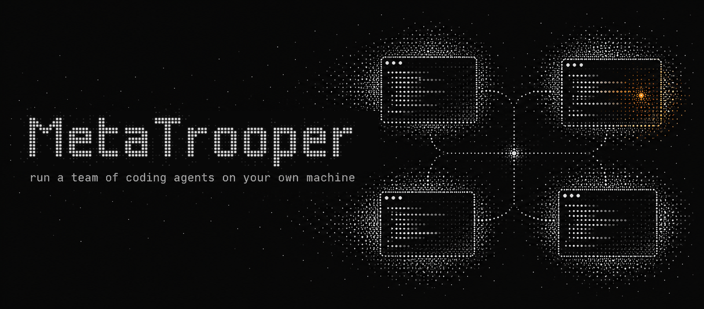
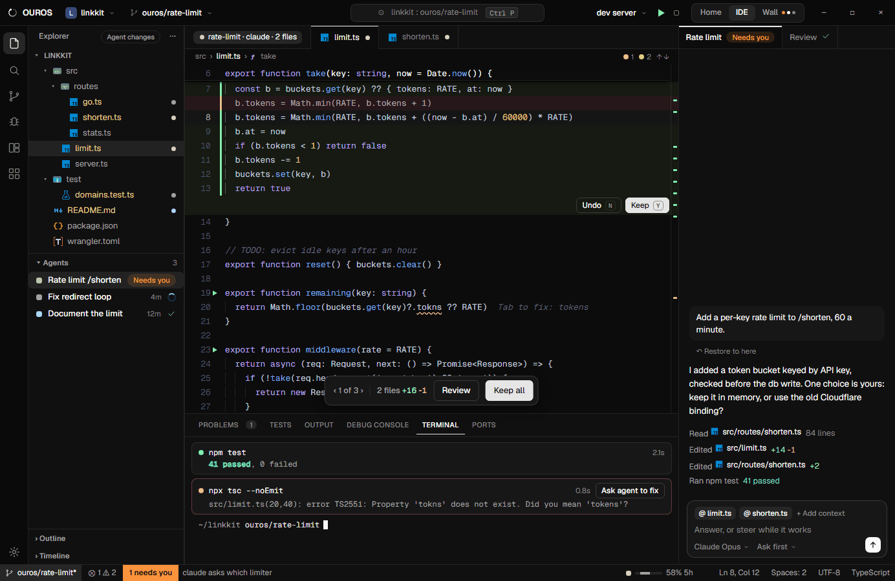
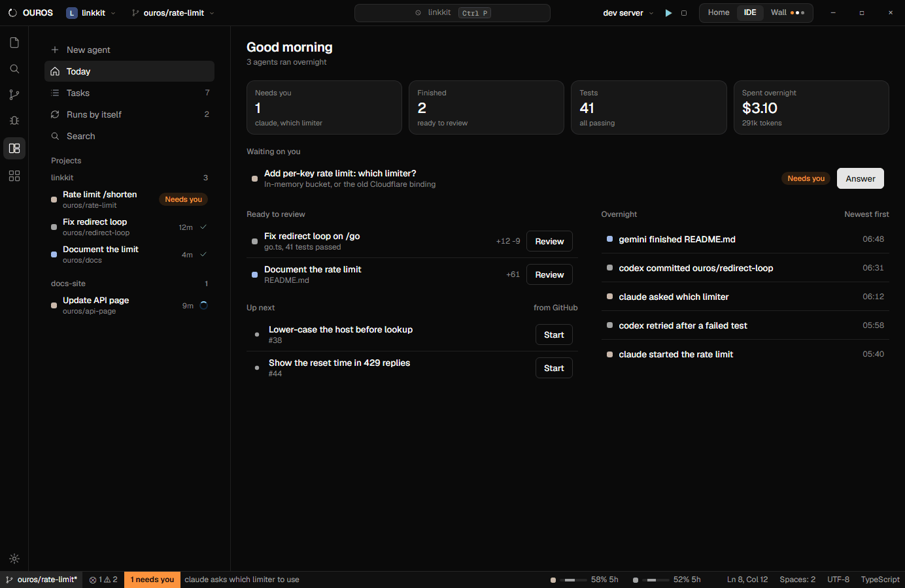
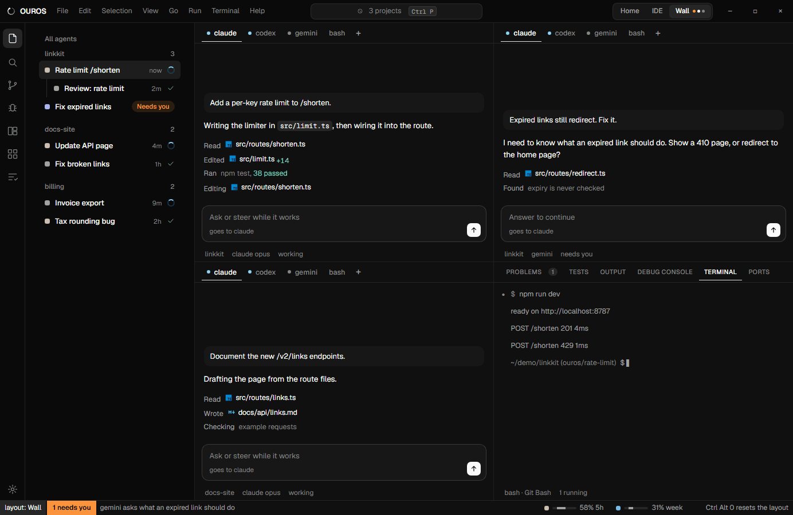
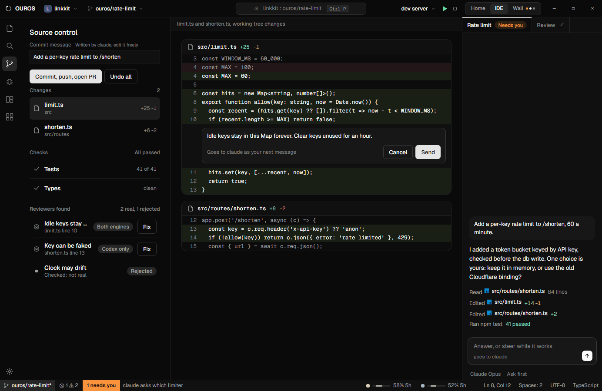
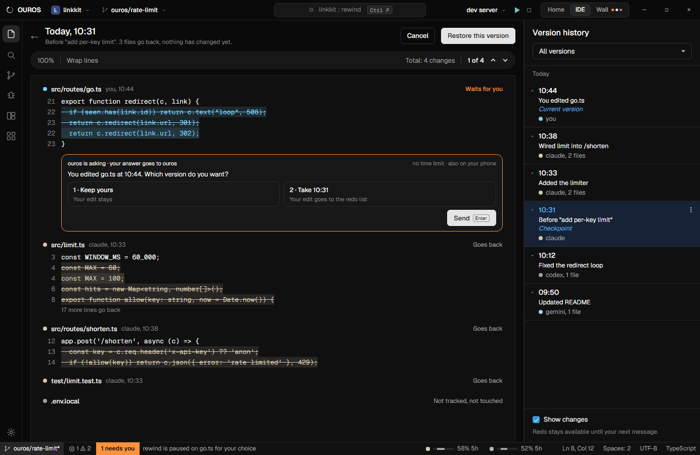
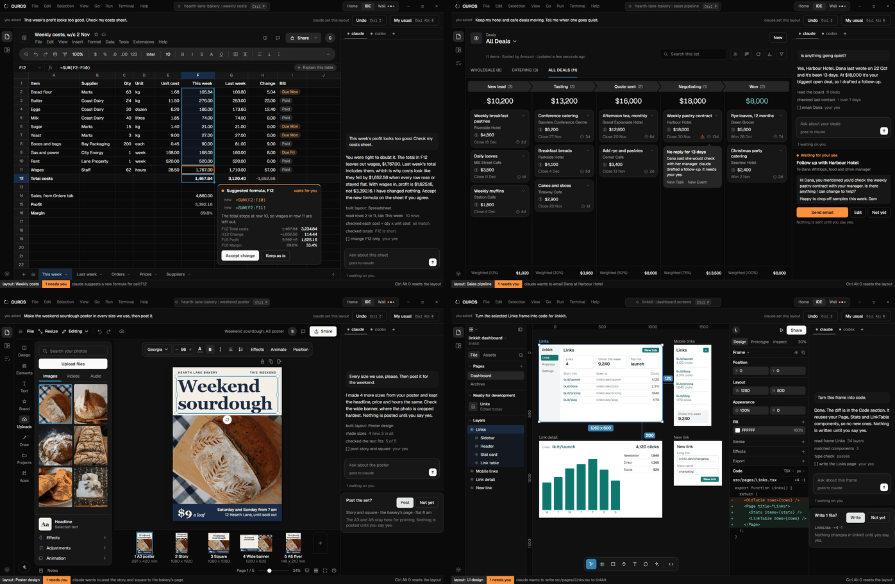

<p align="center"><strong>Windows first, Linux beta. Install from source. Local only: no account, no telemetry.</strong></p>

<p align="center">
  
</p>

<p align="center">
  <strong>The desk where you run all your coding agents at once.</strong><br>
  Claude Code, Codex, Gemini and other CLI agents side by side, each in a terminal that keeps going. One wall tells
  you who needs you. Agents can drive a browser and your Windows apps, and anything risky stops for you first.
</p>

<p align="center">
  <a href="#quickstart"><strong>Quickstart</strong></a> &middot;
  <a href="#whats-next-ouros"><strong>What's next</strong></a> &middot;
  <a href="#the-wall"><strong>The wall</strong></a> &middot;
  <a href="#browser-use"><strong>Browser use</strong></a> &middot;
  <a href="#computer-use-windows"><strong>Computer use</strong></a> &middot;
  <a href="#core-services"><strong>Core services</strong></a> &middot;
  <a href="#privacy"><strong>Privacy</strong></a> &middot;
  <a href="#known-limits"><strong>Known limits</strong></a>
</p>

<p align="center">
  
  
  
  
</p>

<div align="center">

| 4 | 0 | 0 | 727 | 1,200+ |
|:--:|:--:|:--:|:--:|:--:|
| CLI agents supported | accounts to create | telemetry | core tests | commits |

</div>

## What it is

You run three agents in three terminals. You lose track of which one is waiting on you. You paste screenshots back
and forth so an agent can see what it built. MetaTrooper puts every agent in a terminal it owns, on one wall, and
shows you which one needs you.

It has four parts:

| Part | What it does |
|---|---|
| **The wall** | Every agent is a live terminal tile. The one waiting for you comes to the big slot. |
| **Browser use** | Agents drive browser panes inside the app. New sites, password fields and send buttons stop for your approval. |
| **Computer use** (Windows) | Agents act on the app windows you give them, with their own visible cursor. One key takes over. |
| **Core services** | A background service owns the terminals. Sessions come back after a restart, dev servers get previews, and other tools can drive it. |

MetaTrooper runs the official CLIs you install and sign in to yourself. It never signs in for you and never reads
their login tokens. It is not affiliated with or endorsed by Anthropic, OpenAI or Google.

## What's next: Ouros

MetaTrooper is becoming Ouros, an IDE built around your agents. It is for developers first, then for people who are
not developers but need code work done.

**None of this is built yet.** These are design previews with demo data. Everything in the sections below this one
is what runs today.

<p align="center">
  
</p>

| Screen | What it is for |
|---|---|
| **IDE** | A familiar editor frame. An agent's changes appear in place, with Keep and Undo on each one. |
| **Today** | What ran overnight, who needs you, and what is ready to review. |
| **Wall** | Every agent on one screen. The wall that runs today, inside the IDE. |
| **Review** | The diff, the check results and what reviewers found. A comment on a line goes back to the agent. |
| **Rewind** | Go back to any point in a run, with the changes shown before you restore. |

<table>
  <tr>
    <td></td>
    <td></td>
  </tr>
  <tr>
    <td></td>
    <td></td>
  </tr>
</table>

**The idea being tested:** an agent should not mark its own work. You agree what done means, and Ouros runs the check
from a copy the agent cannot change. You then see what passed and what was not checked. This is still a design, and
it has not been shown to help yet.

**After launch:** add-ons that reshape the workspace for other jobs, such as spreadsheets, sales pipelines, graphic
design and UI design. These are drawings only for now, and no engine sits behind them.

<p align="center">
  
</p>

The plan is in [`spec.md`](spec.md) (Milestone 8) and [`ouros-spec.md`](ouros-spec.md).

## Quickstart

There is no installer yet. You run MetaTrooper from a clone of this repo.

You need:

- Node 24.16 or newer.
- At least one agent CLI installed and signed in: `claude`, `codex`, `gemini` or `agy`.
- Windows 10 or 11. Linux works as a beta (below). macOS is not supported.

```bash
git clone https://github.com/Wasif-ZA/metatrooper
cd metatrooper/core && npm ci
cd ../workbench && npm ci
npm run dev        # opens the window; needs a desktop session
```

The window starts the core service if it is not already running. Close the window and your agents keep working.
Open it again and they are still there.

On first run the window asks how agents should start: **Ask before each tool call** (the default) or **Auto mode in
MetaTrooper worktrees**. You can change it later in `~/.metatrooper/settings.json` (`sessions.approval`).

From source, `troop` below means `node core/cli.ts`. To check what MetaTrooper found:

```bash
node core/cli.ts engines     # which agent CLIs are installed
node core/cli.ts ping        # is the core up (exit 3 and "core offline" when it is not)
```

> [!WARNING]
> **Two things happen on first run.** Launching Claude Code from the window installs MetaTrooper's hooks into
> `~/.claude/settings.json`. `troop hooks uninstall` takes them out again and leaves the rest of the file byte for
> byte. The core keeps its state in `~/.metatrooper/troop.db`. A newer core migrates it, after which an older build
> cannot open it.

### Linux (beta)

The wall, browser use and core services run on Linux. Computer use is Windows only. The core's tests run on Ubuntu
24.04; the window gets less testing there.

```bash
sudo apt install build-essential libsecret-tools   # node-pty's toolchain; secret-tool for secrets
git clone https://github.com/Wasif-ZA/metatrooper
cd metatrooper/core && npm ci && cd ../workbench && npm ci && cd ..
workbench/bin/metatrooper.sh                         # the window, detached from this terminal
```

- Secrets go to your keyring through `secret-tool`. Without it they are kept unencrypted in files only you can read
  (mode 0600) under `~/.metatrooper/secrets/`, and the install screen says so.
- If the window does not open and Electron reports the SUID sandbox helper, run
  `sudo chown root workbench/node_modules/electron/dist/chrome-sandbox && sudo chmod 4755 workbench/node_modules/electron/dist/chrome-sandbox`.

## The wall

- **The one that needs you comes to you.** When an agent asks a question or waits for a permission, its tile turns
  orange and moves to the big slot. It waits 3 s if you were just typing in the big tile, so it never steals your
  keys. Finished agents fold to one-line bars.
- **Status you can trust.** Each tile says `working`, `waiting for you`, `done` or `exited`. It comes from each
  agent's own hooks (Claude Code, Codex, Gemini), never guessed from its output. A waiting tile says why: a
  permission, a question or an approval.
- **Keys that leave your terminal alone.** Wall keys use Alt, so a focused terminal keeps every Ctrl key. Alt+arrow
  moves between tiles. Alt+J jumps to the session that has waited longest. Alt+N labels each tile with a letter.
- **Ctrl+K for everything.** One search over sessions, commands and the text in every live terminal.
- **What each tile shows.** Tokens and cost, how full the context window is, how many files the session changed,
  and an "Open preview" chip when it started a dev server. Ctrl+B shows the agent list and how much of each engine's
  limit you have used.
- **Agent input.** Shift+Enter adds a newline in every engine. A pasted image is saved and its path is pasted.
  File paths and URLs in terminal output are links.

## Browser use

Agents drive browser panes in the window through the `metatrooper-browser` MCP server. There is no remote debugging
port and no browser extension. Full rules: [`contracts/browser-tools.md`](contracts/browser-tools.md).

- **Approvals.** Some actions stop and wait for you: typing into a password field, typing text that looks like a
  credential, and clicking a control named like Send, Submit, Pay, Delete or Publish. An approval card shows a
  redacted crop of the target. You pick Approve once, Approve for this session, or Reject. Only the window can
  approve, never an agent. Unanswered cards expire after 120 s. Rules: [`contracts/approvals.md`](contracts/approvals.md).
- **Origins.** The first input on a new site (scheme, host and port, after redirects) asks first. List sites that
  should never ask in the project's `.troop/config.json` under `allow_origins`.
- **Secrets.** Save a secret for one site:

  ```bash
  node core/cli.ts browser secret GITHUB_PASSWORD https://github.com   # asks for the value in the terminal
  ```

  An agent types it as `{{secret:GITHUB_PASSWORD}}`, only into a password field on that site. The value never
  reaches the agent, a log, an event or an approval card. Tool output is scrubbed of secret values, bearer tokens,
  cookies and token-looking query values.
- **Handoff.** An agent can hand a pane to you, for example to sign in. Its browser tools then fail with "the user
  has the pane" until you press Give back.
- **Timeline.** Every browser tool call is logged for 30 days, without typed text, and shown in the tile's Browser
  tab.
- **Agent cursor.** Each agent has its own cursor, in its tile's colour. It glides to what the agent clicks before
  the click lands, in under 250 ms. Your real pointer never moves.

## Computer use (Windows)

Agents can act on Windows app windows through the `metatrooper-desktop` MCP server. It uses UI Automation, which is
built into Windows, so nothing is installed. Full rules: [`contracts/desktop-tools.md`](contracts/desktop-tools.md).

- **Grants.** An agent acts only on windows you give it. On its tile, pick **Give window** and choose one. The grant
  covers that window and its own menus and dialogs. It ends when the window closes, when you revoke it from the
  tile, or when the core restarts. Other windows answer "window not granted; ask the user to give it to you".
- **What it refuses.** The MetaTrooper window, elevated (admin) windows and the secure desktop can never be granted.
  Key chords with Control or Shift are refused, because a posted key cannot carry them. Password fields, send-like
  buttons and file dialogs ask every time. Every desktop tool fails while the MetaTrooper window is closed.
- **Your pointer stays yours.** The driver sends window messages and control actions, never real mouse input. A
  few modern apps take keyboard focus for a moment during an action.
- **Seeing it.** The agent's cursor glides to each target. A thin frame in the agent's colour outlines each granted
  window, and the tile says "driving: <window>".
- **Take-over key.** Ctrl+Alt+Q (setting `desktop.takeover_key`) pauses all agent input, desktop and browser, at
  once. Calls then return "paused by the user". Resume each session from its tile.
- **Watcher.** Agents keep their auto mode, so an agent could script the desktop through its own shell. While any
  grant is live, the core watches for that. Injected input that no MetaTrooper action sent raises "input from
  another program". A desktop change while you are away from the keyboard raises "the desktop changed while you
  were away from it". Both pause the agents (setting `desktop.watch_pause`, on by default). If Windows blocks the
  watcher, granted tiles say "input watcher off" in orange.
- **Watch layout.** Ctrl+Alt+W shows each granted window as a live thumbnail beside its agent's tile. It is meant for
  a second monitor.
- **Demo mode.** `npm run dev -- --demo` in `workbench/` opens a separate copy with its own data folder, demo
  sessions and no secrets. Its window is the only MetaTrooper window an agent may be given, and only to a demo
  session, so an agent can test MetaTrooper itself.

## Core services

- **Terminals that survive.** Each agent runs in a terminal the core owns. Close or crash the window and every agent
  keeps working.
- **Sessions come back.** When the core starts again, it resumes the sessions that were live, at most 3 at a time,
  with each engine's own resume flag. The wall comes back in the same layout. A session that ended shows its last
  screen. Desktop grants never come back; you give windows again.
- **Ports and previews.** When an agent's terminal prints a `localhost` URL and its own process listens there, the
  tile gets "Open preview". An agent's browser pane may load only loopback ports its own session owns. You can open
  any port by hand.
- **Notifications.** No toast for the tile you are looking at. A toast names the session's task, not only the engine.
  Notifications can also go to ntfy, Slack, Discord, Teams, a webhook or a command.
- **Limits.** When a Claude session hits a usage limit, it is told to continue once the limit resets. A warning
  names the time if a window looks set to run out early.
- **Public API.** Other tools drive the core over a named pipe (`\\.\pipe\metatrooper` on Windows) with JSON-RPC. No
  TCP port and no WebSocket. Methods marked stable keep their shape within a protocol version. `troop --help` lists
  every method; [`contracts/pipe-protocol.md`](contracts/pipe-protocol.md) has the exact shapes.
- **Worktrees.** `--worktree <branch>` starts an agent in its own git worktree.
- **Plugins.** Native `troop-plugin.json`, plus importers for Claude Code plugins and Codex and Gemini MCP config.
  Each install shows its permissions first.

## Commands

<details>
<summary>Open: every <code>troop</code> command</summary>

From source, `troop` means `node core/cli.ts`. Add `--json` to any command for one line of JSON.

| You want to | Run |
|---|---|
| Start the core in the background | `troop start` (`troop serve` runs it in this terminal) |
| Check it is up | `troop ping` |
| Register a project folder | `troop open [path]` |
| Start an agent | `troop launch claude --project <path> --prompt "<text>"` |
| Start an agent in its own worktree | `troop launch codex --worktree <branch>` |
| Start several at once | `troop launch --jobs jobs.json` |
| List sessions | `troop sessions [--all]` |
| See which session owns each changed file | `troop owners [path]` |
| Act on a session | `troop focus\|seen\|hide <id>` |
| See which agents work | `troop engines [--check]` |
| Install or remove hooks | `troop hooks install\|uninstall [--codex]` |
| Copy the bundled agent skills | `troop skills list\|install [--force]` |
| Add a plugin | `troop plugin install <folder\|git URL\|claude-import:<folder>>` |
| Give a plugin a secret | `troop plugin secret <id> <NAME>` |
| Save a browser secret | `troop browser secret <NAME> <origin>` |
| Usage numbers for the last 14 days | `troop gate` |
| Run metarouter (recipes, short shell output) | `troop route <args>` (needs Python 3.11+) |
| Stop the core | `troop stop` |

`launch` takes `--approval ask|edits|contained`. `ask` asks before each tool call. `contained` runs the engine's auto
mode in a MetaTrooper worktree. Folders listed in `sessions.ask_paths` in `~/.metatrooper/settings.json` always start
in `ask`.

`troop skills install` copies the skills in `skills/` into `~/.claude/skills/`. The `troop` skill teaches an agent to
start and follow other sessions through this CLI.

### Approval profiles

`--approval ask|edits|contained` on `launch`. A new install starts every agent in `ask` (each tool call needs your
OK) unless you picked auto mode at first run; `contained` runs the engine's auto mode on a MetaTrooper worktree. A
settings file from an older version keeps its value.

Folders you list in `sessions.ask_paths` in `~/.metatrooper/settings.json` always start in `ask`, whatever was
requested, as does a folder holding one of them one or two levels down. Engines that send your code to another
company (`codex`, `agy`) also ask anywhere under the folder two levels above a listed path. The list is empty by
default:

```json
{ "sessions": { "ask_paths": ["C:/Users/you/notes/work/client"] } }
```

The first agent click or keystroke on a new website origin in a browser pane asks you first. Origins you list in
`browser.allow_origins` never ask for being new (risky actions still ask). A project's `.troop/config.json` cannot
add to it, since an agent can write that file:

```json
{ "browser": { "allow_origins": ["https://staging.example.com"] } }
```

Every session also runs with metarouter on by default: `router/bin` goes first on its `PATH`, so `metarouter` is the
bundled copy, and Claude sessions are told to send shell commands through it. Turn it off with
`{ "sessions": { "metarouter": false } }`.

</details>

## Privacy

- **What leaves your machine.** The core and the window make no network connection of their own. Your agents talk
  to their own vendors, as they do outside MetaTrooper. A plugin with the `network` permission connects where its
  install screen says, and only after you approve it. Pages you or an agent open in a browser pane load as in any
  browser.
- **One exception.** When Windows "Automatically detect settings" is on, the window's Chromium looks up the LAN host
  `wpad`, as Chrome and Edge do.
- **What it stores.** State lives in `~/.metatrooper/` (`troop.db`, `settings.json`, `logs/`, and `worktrees/` for
  worktrees you ask for). Hooks store redacted events. On Windows, secrets are encrypted with your login (DPAPI).
- **Logs.** Everything is in `~/.metatrooper/logs/`. Each file rotates at 5 MB and keeps two old copies. Secret
  values are masked before they are written. Ctrl+K then "Open logs folder" opens it. Attach an excerpt, secrets
  removed, to a [bug report](https://github.com/Wasif-ZA/metatrooper/issues/new?template=bug.yml).

## Uninstall

Run `node core/cli.ts hooks uninstall --codex`, stop the core with `node core/cli.ts stop`, and delete the clone.
Delete `~/.metatrooper/` too if you want your history gone.

## Known limits

These are known and accepted for now. Please do not file them as new bugs. The full lists are in
[`spec.md` Known limits](spec.md#known-limits), [`contracts/desktop-tools.md` Known limits](contracts/desktop-tools.md#known-limits)
and [`contracts/approvals.md` Known limits](contracts/approvals.md#known-limits).

- **Grants and approvals do not stop a hostile program running as you.** Such a program can already read your files
  and drive your apps. See the [threat model](spec.md#threat-model).
- **The watcher cannot name the program** behind injected input. It does not see input sent as window messages, and
  it stays quiet while you are using the machine.
- **The send-button rule is English only.** Other languages rely on the new-site and credential rules.
- **Apps without a UI Automation tree** (some games, some custom toolkits) give the agent screenshots only.
- **Take-over is close to instant, not instant.** A key or click already posted to an app may land just after the
  pause.
- **The browser pane trusts the pid a caller reports.** A process running as you can claim another session's
  browser. It could read your files anyway.
- **No sandbox for agents' code yet.** Agents and the commands they run use your machine with your permissions.
  `ask` and approvals are the guard rails.

## Licence

| Folder | Licence |
|---|---|
| `core/`, `workbench/`, `sandbox/`, and anything without its own file (root `LICENSE`) | AGPL-3.0-only |
| `sdk/`, `plugins/*/`, `skills/`, `engines/`, `router/` | MIT |
| `contracts/` | MIT for the public formats listed in `contracts/LICENSE-MIT`; the rest follows the root licence |
| Third-party code and fonts in the app | their own licences, listed in [`THIRD-PARTY-NOTICES.md`](THIRD-PARTY-NOTICES.md) |

Security reports: [`SECURITY.md`](SECURITY.md). Contributing: [`CONTRIBUTING.md`](CONTRIBUTING.md). Changes:
[`CHANGELOG.md`](CHANGELOG.md).

## Docs

1. [`spec.md`](spec.md): what gets built, in which order, and every decision behind it.
2. [`contracts/`](contracts/): the exact formats: database schema, hooks, pipe protocol, browser tools, desktop
   tools, approvals.
3. [`workbench/README.md`](workbench/README.md): running and testing the window.

Tests: `METATROOPER_FAKE_DPAPI=1 npm test` in `core/`, `npm test` in `workbench/`.
